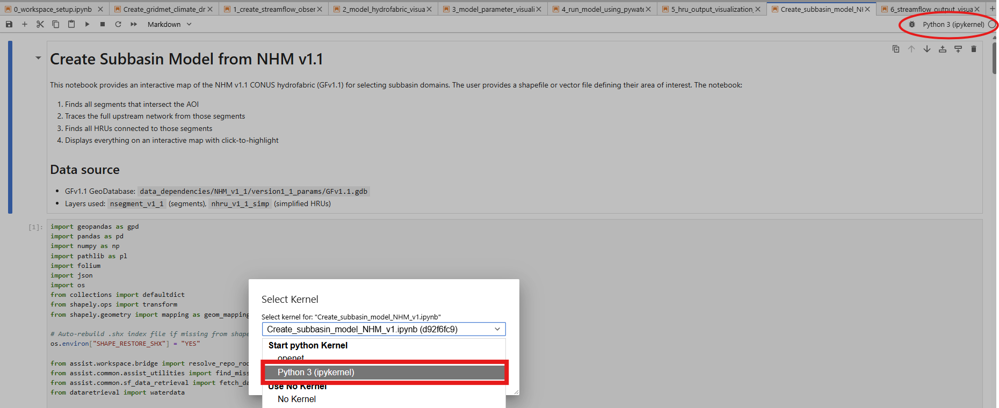
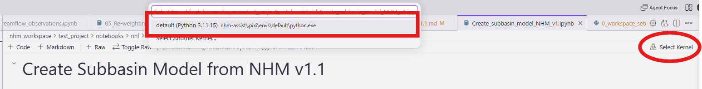

# Building a Watershed Model from the Geospatial Fabric v1.1

<p align="center">
  
</p>

**A step-by-step guide for the Fall 2026 nhm-assist training class**

In this class you will build your own pywatershed watershed model directly from
the Geospatial Fabric version 1.1 (GFv1.1) using the construction tool, then
evaluate, run, and interpret it with the nhm-assist notebooks.

Wherever you see a placeholder in `<angle-brackets>`, substitute your own
workspace name, project name, or model name. The companion reference for every
command is the repository [README.md](./README.md); this sheet is the ordered
path through the class.

---

## Before you begin — Review Setup Checklist

> **⏱ Do this first.** The data dependencies (first item below) are a **~4 GB**
> download from SharePoint that can take 30+ minutes on a slow connection, and
> **no notebook will run without them.** Start the OneDrive sync now — full
> steps in [Getting the data dependencies](#appendix--getting-the-data-dependencies) —
> so it downloads in the background while you work through the rest of this
> checklist and Steps 1–2.

- **Copy the data dependencies from the SharePoint site (START THIS FIRST).**
  The nhm-assist data dependencies (the GFv1.1 geodatabase, reference and
  non-reference gage data, HUC and map layers, and more — roughly **4 GB**) are
  not in the git repository. They live on the USGS SharePoint site
  [usgs-nhm-assist-dependencies](https://doimspp.sharepoint.com/sites/usgs-nhm-assist-dependencies/Shared%20Documents/Forms/AllItems.aspx)
  and you copy them into the repository's `data_dependencies/` folder before
  running any notebook. The reliable way to do this is to sync the library to
  your machine with OneDrive and then copy from that local copy — see
  [Getting the data dependencies](#appendix--getting-the-data-dependencies).
  Because the download is large, **kick it off before anything else** and let it
  finish while you do the rest of this checklist.
- **pixi installed.** NHM-Assist uses pixi for dependency and environment management.
  Install pixi per the [official instructions](https://pixi.sh/latest/#installation).
  It is the only supported environment manager — do not use `pip`, `conda`, or
  `venv`. Once the nhm-assist repository is cloned, install the environment from a `powershell terminal`:

  ```bash
  git clone https://code.usgs.gov/wma/hytest/nhm-assist.git
  cd nhm-assist
  pixi install
  ```

  `pixi install` builds the environment under `.pixi/envs/default/`; every
  `pixi run …` command in this guide uses it automatically. **⏱ The first
  `pixi install` downloads and builds the whole environment and can take
  several minutes** (longer on a slow connection) — this is normal, let it
  finish.
- **A shapefile of your area of interest (AOI).** This is the only data you
  supply — the watershed you want to model, as a shapefile (`.shp` **plus its
  sidecar files**, e.g. `.dbf`, `.shx`, `.prj`) or other vector file.
  **No shapefile of your own?** Use the example AOI that ships with the data
  dependencies: `data_dependencies/Examples/Malheur_Lake.shp` (Malheur Lake,
  Oregon). It comes with all its sidecar files, so you can work through the
  whole guide with it.
- **An editor for the notebooks.** In this training we run the Jupyter notebooks
  in **Jupyter Lab**. If you prefer **VS Code** or **Kiro**, you must install three
  extensions first (see the steps just below):
  - **Python** — if a separate **Python Environments** extension is also
    installed, disable it; it can cause errors.
  - **Jupyter**
  - **Jupyter Sync**

  **How to install an extension in VS Code or Kiro:**
  1. Open the **Extensions** view. Click the Extensions icon in the left-hand
     Activity Bar (four squares, the top-right one detaching):

     

     Or use the keyboard shortcut **Ctrl+Shift+X**.
  2. In the **Search Extensions in Marketplace** box at the top of the panel,
     type the extension name — for example `Python`.
  3. Find the correct result in the list (publisher **Microsoft** for both
     **Python** and **Jupyter**) and click **Install**.
  4. Repeat the search-and-install for each of the three extensions above
     (**Python**, **Jupyter**, **Jupyter Sync**).
  5. After installing, if you also see a **Python Environments** extension,
     click its gear icon → **Disable** to avoid kernel-selection errors.

  You only install these once per machine; they persist across projects.
- **Awareness that one step needs the VPN off.** [Step 7](#step-7) (gridMET
  climate drivers) must run with the VPN disconnected; every other step runs
  fine on the VPN. See [Step 7](#step-7) for details.
-  **[Request a USGS WaterData Access Token](https://api.waterdata.usgs.gov/signup/)** [Step 8](#step-8) (Gather observed streamflow)
  Requests streamflow data from the USGS WaterData service. If the request includes
  a large amount of gages or observations, a token may be needed.

All commands in this guide are run from the **repository root** (the `nhm-assist`
folder you cloned) unless stated otherwise.

```bash
PS D:\nhm-assist>
```

> **Hit a snag?** Check the [Troubleshooting](#appendix--troubleshooting)
> appendix — it lists the common errors (missing data dependencies, VPN state,
> kernel/environment issues) and their fixes. Still stuck? You're also welcome
> to hang out after class, [sign up for an office-hour session](https://doimspp.sharepoint.com/:x:/s/gs-wma-hytest/IQCrL-RGf4mwTKFtzp8_vjatAQcfIDBq_GMx0qDGzShKB8I),
> or reach out to the instructors directly.

### Getting updates during the class

We may push fixes or improvements to the repository during the training. When
an instructor asks you to update, pull the latest code and re-sync your
environment from the **repository root**:

```bash
git pull
pixi install
```

- `git pull` brings in the updated code and notebook templates.
- `pixi install` re-syncs your pixi environment to match; if the dependencies
  changed, it updates them, otherwise it is a quick no-op.

> ⚠️ **After a `git pull`, reopen any notebook you had open before working in
> it.** Your notebooks are paired to the repo templates, so if you keep working
> in a notebook opened before the pull, your next **save** overwrites the
> template update you just pulled with your stale copy. Close the notebook and
> reopen it so it picks up the change.

> 📝 **If an update changes a notebook template,** you may also need to
> regenerate your project's notebooks to pick it up (re-run the
> [Step 2](#step-2) generator). An instructor will tell you when that is
> needed.


## Preview

| # | Step | Where |
| --- | --- | --- |
| 1 | [Create a workspace and a project](#step-1) | `pixi run setup` |
| 2 | [Generate the NHM training notebooks](#step-2) | `scripts/Make_NHM_v1_1_training_notebooks.py` |
| 3 | [Delineate your watershed fabric from GFv1.1](#step-3) | `nhf/Create_subbasin_model_NHM_v1` |
| 4 | [Build the model from the v1.1 parameter geodatabase](#step-4) | `nhf/gf_params_parse_v1_1` |
| 5 | [Import the model into your project](#step-5) | `pixi run setup` |
| 6 | [Run notebook 0 to set model paths & options](#step-6) | `nhm/0_workspace_setup` |
| 7 | [Create climate forcing data (**VPN off**)](#step-7) | `nhf/Create_gridmet_climate_drivers` |
| 8 | [Gather observed streamflow](#step-8) | `nhm/1_create_streamflow_observations` |
| 9 | [Verify the hydrofabric](#step-9) | `nhm/2_model_hydrofabric_visualization` |
| 10 | [Inspect model parameters](#step-10) | `nhm/3_model_parameter_visualization` |
| 11 | [Run the model with pywatershed](#step-11) | `nhm/4_run_model_using_pywatershed` |
| 12 | [Explore HRU output](#step-12) | `nhm/5_hru_output_visualization_new` |
| 13 | [Evaluate simulated streamflow](#step-13) | `nhm/6_streamflow_output_visualization_new` | |

[Steps 1](#step-1)–[2](#step-2) set up your workspace, project, and notebooks.
[Steps 3](#step-3)–[5](#step-5) build and register your model.
[Step 6](#step-6) configures it. [Steps 7](#step-7)–[13](#step-13) are the
`nhm` workflow: run them in order, each builds on the files the previous one
wrote.

---

<a id="step-1"></a>
## Step 1 — Create a `workspace` (workspace root) and a `project`

Everything you make in this class — your project, your model, the generated
notebooks, and all output — lives in a **workspace** folder that sits *outside*
the cloned nhm-assist repository. Keeping it outside the repo is what keeps your
work out of git and separate from the shared code and notebook templates. A
workspace holds one or more **projects**, and each project holds one or more
models plus one set of generated notebooks.

From the repository root, launch the guided setup menu:

```bash
pixi run setup
```

This drops you into an interactive menu. You will see guided options at the top
(do these in order) and more options below:

```text
NHM setup

Workspace root: D:\nhm-workspace
Current project: (not selected)
Active model: (not set)
USGS WaterData API key: configured

  -- Guided setup (do these in order) --
  1. Set workspace root
  2. Create project
  3. Copy example model
  4. Show notebook folder and how to open it

  -- More options --
  5. Open existing project
  6. Import model folder
  7. Set active model
  8. Generate NHM notebooks 
  9. Show current setup 
  10. Set USGS WaterData API key 
  11. Repair editor settings for this project 
  0. Exit 
```

> 📝 **Fresh setup:** the first time you run `pixi run setup` — before any
> workspace root is saved — the tool takes you straight to this
> `Workspace root path:` prompt. Once a workspace root has been set, later
> `pixi run setup` sessions land on the menu above, where you choose option `1`
> only if you want to change it.

### Set the workspace root (Fresh Setup)

```text
Workspace root path:
```


- **Press Enter to accept the default.** The default is a folder named
  `nhm-workspace` placed next to the cloned repository (for example, if the repo
  is at `.../nhm-assist`, the default workspace is `.../nhm-workspace`). This is
  the recommended choice for the class.
- To use a different location, type a full path instead. Pick somewhere
  **outside** the cloned repository — the tool warns you if you point it inside
  the repo, because that would mix generated files into your git checkout.
- If the folder does not exist yet, the tool asks `Create this folder?` — answer
  `y`.

The tool saves your choice to a `.env` file in the repo
(`NHM_ASSIST_WORKSPACE_ROOT`), so later `pixi run setup` sessions remember it
and you won't have to set it again.

### Create a project (menu option 2)

Choose option `2` and give your project a name when prompted. Use a short,
descriptive name for your watershed, with no spaces — for example
`my_watershed` or `coastal_oregon`.

This creates the project folder structure inside your workspace:

```text
<workspace>/
└── <project>/
    ├── notebooks/
    │   └── nhm/                     # your generated notebooks (Step 2)
    ├── project_config/
    │   └── active_model.yaml        # records which model is "active"
    └── models/                      # your constructed model lands here
```

Each project also gets two things that make your work reviewable in git:

- a `jupytext.toml` that pairs every notebook to a `.py` file beside it, so
  diffs show code rather than notebook JSON; and
- a `.vscode/` folder that configures the Jupytext Sync extension to sync on
  open and on save (this works in both VS Code and Kiro).

### What you have after Step 1

- A workspace folder outside the repo, remembered in `.env`.
- An empty project inside it, with its `notebooks/` and `models/` folders ready.

Your project has **no model yet** — that is expected. First you generate this
project's notebooks ([Step 2](#step-2)); then you build the model
([Steps 3](#step-3)–[4](#step-4)).

> 💡 **Tip:** You can re-run `pixi run setup` at any time. It remembers your
> workspace, and option **9, "Show current setup,"** prints your current
> workspace, project, and active model if you lose track of where you are.

---

<a id="step-2"></a>
## Step 2 — Generate the NHM training notebooks

Your project folder exists, but it has no notebooks in it yet. This step
generates them from the shared templates in the repository, writing a fresh set
of training notebooks into your project's `notebooks/` folder. These are the
notebooks you work through for the rest of the class.

In a new terminal, from the nhm-assist repository root, run the training-notebook generator, substituting your
own workspace root and project name:

```bash
pixi run python scripts/Make_NHM_v1_1_training_notebooks.py --workspace-root </path/to/workspace> --project-name <MyProject>
```

- `--workspace-root` — the workspace folder you set in [Step 1](#step-1) (for
  example the default `nhm-workspace` next to the repo).
- `--project-name` — the project you created in [Step 1](#step-1).

The generator pairs each notebook to a `.py` template (via jupytext), so your
edits show up as readable diffs in git rather than as notebook JSON.

> 📝 **Why this script instead of menu option 8?** For the training class this
> script generates a **focused subset** of the notebooks — the ones that guide
> you from building a fabric and model parameter files, through running
> pywatershed, to evaluating model output. That is the path this guide follows.
> The setup menu's option **8, "Generate NHM notebooks,"** generates the broader
> notebook set; use this script (not option 8) so your project has the curated
> training sequence.

### What you have after Step 2

- The focused set of training notebooks under
  `<workspace>/<project>/notebooks/`, ready to open and run — covering fabric
  and parameter-file construction, running the model with pywatershed, and
  evaluating the output.

---

<a id="step-3"></a>
## Step 3 — Delineate your watershed fabric — `notebooks/nhf/Create_subbasin_model_NHM_v1.ipynb`

> 📝 **Opening this notebook?** How you open it and set its kernel depends on your
> editor (Kiro, VS Code, or Jupyter Lab). See
> [Opening the notebooks](#appendix--opening-the-notebooks-kiro-vs-code-or-jupyter-lab)
> in the appendix. You do this once per notebook, at the start of every notebook
> step.

In this class you construct your own pywatershed model directly from the NHM
version 1.1 geospatial fabric and parameter database, using two notebooks (workflows) in the **`nhf`**
subdirectory. This step runs the first of them, which helps delineates your watershed
fabric from your AOI shapefile; [Step 4](#step-4) then turns that fabric into a
pywatershed model.

> 📝 **What you need before you start:** a shapefile (or other vector file)
> defining your **area of interest (AOI)** — the watershed you want to model.
> This is the only input you have to supply. No shapefile of your own? Use the
> example `data_dependencies/Examples/Malheur_Lake.shp`, or build one from a
> HUC code as shown next.

> 💡 **Tip — build an AOI from a HUC code.** If you know the watershed's
> Hydrologic Unit Code, you can pull its boundary straight from the USGS
> National Map Watershed Boundary Dataset (WBD) with `geopandas` and save it as
> a shapefile — no manual digitizing. For a HUC10, query the WBD HUC10 layer by
> its code:
>
> ```python
> import geopandas as gpd
>
> huc = "1709000304"  # your 10-digit HUC code
> url = (
>     "https://hydro.nationalmap.gov/arcgis/rest/services/wbd/MapServer/5/query"
>     f"?where=huc10%3D%27{huc}%27&outFields=*&f=geojson"
> )
> aoi = gpd.read_file(url)
> aoi.to_file("my_aoi.shp")   # or .gpkg
> ```
>
> Layer `5` on that service is HUC10; use layer `6` and field `huc12` for a
> HUC12, layer `4`/`huc8` for a HUC8. If the query comes back empty, open
> <https://hydro.nationalmap.gov/arcgis/rest/services/wbd/MapServer> in a
> browser to confirm the current layer number and code field name — they can
> shift between service versions.

This notebook presents an interactive map of the NHM v1.1 CONUS hydrofabric
(GFv1.1) and uses your AOI shapefile to carve out the subbasin that drains your
watershed. From your AOI it:

1. finds every stream segment that intersects your area of interest;
2. traces the full **upstream** network from those segments;
3. finds all HRUs connected to those segments; and
4. displays the result on an interactive, click-to-highlight map so you can
   confirm the delineation looks right.

**Input:** your AOI shapefile/vector file.
**Output:** a watershed modeling fabric (the delineated segments and HRUs for
your subbasin), written into your **project's** `fabrics` folder — not back into
the repository.

The notebook reads the GFv1.1 geodatabase from the repo's data dependencies
(`data_dependencies/NHM_v1_1/version1_1_params/GFv1.1.gdb`), using the segment
layer (`nsegment_v1_1`) and the simplified HRU layer (`nhru_v1_1_simp`). You do
not need to download the fabric separately — it ships with the project's data
dependencies.

> 💡 **Tip:** If your shapefile is missing its `.shx` index, the notebook
> rebuilds it automatically (it sets `SHAPE_RESTORE_SHX=YES`), so a shapefile
> that is only `.shp` + `.dbf` + `.prj` will still load.

### What you have after Step 3

- A delineated watershed fabric for your AOI, in the project's `fabrics` folder.

---

<a id="step-4"></a>
## Step 4 — Build the pywatershed model from the v1.1 parameter geodatabase — `notebooks/nhf/gf_params_parse_v1_1.ipynb`

With your watershed fabric in hand, this notebook builds a complete pywatershed
model for it by parsing the model's parameters out of the **NHM version 1.1
parameter geodatabase** and writing them to a PRMS parameter file. Working
through [`pyPRMS`](https://github.com/paknorton/pyPRMS), it reads the v1.1
parameter database, subsets each parameter to the HRUs and segments in your
fabric, builds and validates the stream-segment routing network (checking for
disconnected or looped graphs), and writes out the parameter file your model
needs.

**Input:** the watershed modeling fabric from [Step 3](#step-3), plus the NHM
v1.1 parameter geodatabase (from the project's data dependencies).
**Output:** a pywatershed-ready model — the PRMS parameter file and model
inputs — written to your **project** workspace (not back into the repository).


### What you have after Step 4

- A pywatershed model built from your fabric and the NHM v1.1 parameter
  geodatabase, in the project's `fabrics` folder.

This is the model the nhm-assist notebooks (`0`–`6`) will evaluate, run, and
interpret in the steps that follow. In the next step you bring it into your
project with `pixi run setup`.

---

<a id="step-5"></a>
## Step 5 — Import your fabric and parameter files

Now bring the fabric and parameter files you built in [Step 4](#step-4) into your project so nhm-assist
notebooks can find them.

```bash
pixi run setup
```
First, Choose option **5, "Open existing project."** And select your project.

Then, Choose option **6, "Import model folder."** The tool asks two questions:

```text
Type model name:
Type source folder path:
```

- **Model name** — a short name for this model inside your project (we suggest using the 
  name of the fabric folder (named from the aoi.shp file).
   This becomes the folder name under the project's
  `models/`.
- **Source folder path** — the full path to the fabric folder you built in [Step 4](#step-4). 
  (for example `<workspace>/<project>/fabrics/<your fabric name>/`)

The tool copies all files from the fabric folder into your project's model folder at
`<workspace>/<project>/models/<model-name>/` and prints where it landed:

```text
Imported model to <workspace>/<project>/models/<model-name>
```

**Importing also sets this model active automatically** — it writes the model
name into `project_config/active_model.yaml`, so you do not need a separate
"set active model" step. The nhm-assist notebooks resolve the active model from
that `active_model.yaml`.

> 📝 **Why import instead of pointing at it in place?** Importing creates multiple copies fabric and parameter
> files to the model folder (source and runtime copies). The nhm-assist notebooks with modify the parameter files (runtimes folder),
> but preserve original imported values (source folder). 

### What you have after Step 5

- Your model fabric, parameter file and control file copied into `<workspace>/<project>/models/<model-name>/`.
- Imported model is recorded as the project's **active model**.

To confirm, re-run `pixi run setup` and choose option **9, "Show current
setup"** — it prints your workspace, project, and active model.

---

<a id="step-6"></a>
## Step 6 — Run notebook 0 (`0_workspace_setup.ipynb`)

> 📝 **Note:** Using `pixi run setup`, you must set your workspace, project, and
> active model before running notebook 0 (and any notebook).

Notebook 0 is the setup notebook every nhm-assist notebook depends on: it picks
up the active model you imported in [Step 5](#step-5), resolves and records your workspace,
project, and model paths, creates the output folders, and captures the options
the evaluation notebooks (Steps 8–13) read. **From now on, run notebook 0 first
at the start of every working session.**

### 6a. Open `0_workspace_setup.ipynb`

Open notebook 0 and point it at this project's pixi environment (`.pixi/envs/default`).
 The exact steps depend on your editor (Kiro, VS Code, or Jupyter Lab) — see
[Opening the notebooks](#appendix--opening-the-notebooks-kiro-vs-code-or-jupyter-lab)
in the appendix.

### 6b. Run the environment sanity check (first cell)

Run the **first cell and read its output.** It checks whether packages outside
this environment are shadowing the versions pixi locked (a `pip install --user`
from any other project can do this). If it prints a warning, launch Jupyter
through pixi or set `PYTHONNOUSERSITE=1` in your kernel environment before
continuing. If it prints nothing, you're clear.

### 6c. Review the user options

Work down the cells marked **✍ Enter Information** and set each to taste. Most
are detected or defaulted sensibly for a model you just built, so for a first
run you can often accept the defaults:

- **NHM domain folder name** (`subdomain`) — **ignored in your project.** When
  the notebook runs from a workspace project it overwrites this with your
  project's active model name (the one you imported in [Step 5](#step-5)). You will see
  `Active model:` printed. The hardcoded value only matters in the legacy
  in-repo layout.
- **GIS file format** (`GIS_format`) — auto-detected from your model
  (`.gpkg` or `.shp`). Override only if detection is wrong.
- **Parameter file name** (`param_file`) — defaults to `myparam.param`, the
  file your construction step produced.
- **Control file name** (`control_file_name`) — auto-detected, preferring the
  bandit-subset control file.
- **Minimum streamflow observations** (`waterdata_gage_nobs_min`) — default
  `365` days. Controls which extra WaterData gages notebook 2 shows.
- **List of parameters** (`nhru_params`, `nhru_nmonths_params`) — which
  parameters notebook 3 will visualize. Defaults are the NHM v1.1 calibration
  parameters.
- **List of output variables** (`selected_output_variables`) — which model
  outputs notebooks 5 and 6 will visualize (recharge, actual ET, segment
  outflow, snowmelt, and so on).
- **Calendar years vs. water years** (`water_years`) — default `True` (water
  years, Oct 1 – Sep 30). Set `False` for calendar years.

### 6d. Run the rest and SAVE

Run the remaining cells. They resolve all paths, create the model's output
folders (`notebook_output_files/` with `html_maps`, `html_plots`, `nc_files`,
`Folium_maps`), detect the fabric version, and write your choices to a config
file the other notebooks read.

**Then save the notebook.** Your entered options are only retained once you
save — the notebook itself says *"NOT FINISHED YET! SAVE YOUR NOTEBOOK"* for
exactly this reason.

### What you have after Step 6

- Paths, directories, and output folders set up under your active model.
- Your parameter, gage-threshold, visualization, and water-year choices recorded
  for notebooks 1–6.

You are now ready to work through notebooks 1 through 6 in order.

---

<a id="step-7"></a>
## Step 7 — Create climate forcing data — `notebooks/nhf/Create_gridmet_climate_drivers.ipynb`

> **⏱ This step can take several minutes.** It downloads gridMET data over the
> network and area-weights it onto your HRUs; the fetch is the slow part and
> scales with the size of your domain and the simulation period. It is working
> even when it looks idle — give it time before assuming it has stalled.

Your model has parameters and a fabric, but it still needs **climate forcing**:
the daily weather that drives the simulation. This notebook generates gridMET
climate driver files for your subdomain, so pywatershed has something to run on
in the next step.

Using [`gdptools`](https://gdptools.readthedocs.io/), it takes your model's HRU
polygons and area-weights the gridMET grid onto them, producing three forcing
files:

- `prcp.nc` — precipitation
- `tmin.nc` — daily minimum temperature
- `tmax.nc` — daily maximum temperature

These land in your model directory, ready for pywatershed in [Step 11](#step-11). The
notebook reads your model's HRUs from `GIS/model_layers.gpkg` and the
simulation period (start and end dates) from the config that notebook 0 wrote,
so there is little to configure — just run it top to bottom.

> ⚠️ **You must disconnect from the VPN before running this notebook.** It pulls
> gridMET data over OPeNDAP from `thredds.northwestknowledge.net`, and the
> USGS/DOI VPN proxy blocks that connection. Disconnect from the VPN first, or
> run the notebook on a Hovenweep Data Transfer Node (hw-dtn1 / hw-dtn2), which
> has unrestricted internet access. If you leave the VPN on, the data fetch
> fails.

> 📝 **Catalog note:** the notebook uses a local copy of the climateR catalog
> (`data_dependencies/climateR_catalog.parquet`) when present, and only reaches
> out to GitHub for it if that local file is missing — one less thing the
> network has to reach.

### What you have after Step 7

- `prcp.nc`, `tmin.nc`, and `tmax.nc` climate forcing files in your model
  directory, covering your model's simulation period.

Your model now has everything it needs to run: fabric, parameters, and climate
drivers.

---

<a id="step-8"></a>
## Step 8 — Gather observed streamflow — `notebooks/nhm/1_create_streamflow_observations.ipynb`

From here on you are in the numbered `nhm` notebooks. Notebook 1 collects the
**observed** streamflow you will later compare your simulation against. It
retrieves records for the gages in and around your subdomain, assembles them
into one observations file, and makes diagnostic plots.

What it does, in order:

1. **Retrieves WaterData gage information and streamflow.** Pulls time-series
   data for all USGS WaterData gages in your domain, filters to the simulation
   period, and writes `metadata/WaterDataGages.csv`. It keeps gages whose period
   of record meets the `waterdata_gage_nobs_min` threshold you set in notebook 0,
   **plus** every gage in the parameter file regardless of record length.
2. **Builds `default_gages.csv`.** Combines the parameter-file gages with the
   WaterData gages found in your domain.
3. **Adds state and bureau data where applicable.** Integrates state-collected
   daily streamflow for subdomains in **Oregon and Washington**, and Bureau of
   Reclamation Hydromet unregulated flow (QU) where available. Run these cells
   even if your subdomain is outside those areas — they are written to be
   skipped cleanly.
4. **Writes the observations file `sf_efc.nc`.** Classifies the daily
   observations into Environmental Flow Components (EFC) and writes an encoded
   NetCDF formatted to match the model's `sf.nc`.
5. **Makes diagnostic plots.** Plots discharge and EFC for a selected gage, and
   saves daily-streamflow plots as HTML for every gage in the gage list.

> ⚠️ **If `default_gages.csv` is missing site information:** a gage in your
> parameter file may not exist in WaterData. The notebook flags this with an
> error. To fix it, fill in the missing site info manually in `resource_gages.csv`, and re-run the notebook — once `resource_gages.csv` has the missing information, the notebook
> uses it to source the missing metadata.

> 📝 **WaterData API key (optional).** If retrieval is slow or rate-limited, set a
> USGS WaterData API key through `pixi run setup` → option **10, "Set USGS
> WaterData API key."** It is stored in the repo's `.env`.

### What you have after Step 8

- `metadata/WaterDataGages.csv` and `default_gages.csv` (or your edited
  `gages.csv`).
- The observed-streamflow file `sf_efc.nc` with EFC classification.
- Diagnostic streamflow plots saved as HTML under your model's output folder.

---

<a id="step-9"></a>
## Step 9 — Verify the hydrofabric — `notebooks/nhm/2_model_hydrofabric_visualization.ipynb`

Before running the model, confirm the fabric you delineated in [Step 3](#step-3) is correct.
Notebook 2 draws your subdomain's hydrofabric on an interactive map so you can
check that it is put together the way you expect.

It helps you verify:

- the **model location** — your subdomain is where it should be;
- **HRU-to-segment connections** — each HRU drains to the right stream segment;
- **segment routing order** — flow routes downstream correctly; and
- **gage placement** — gages sit on the segments they are meant to measure.

The map displays HRUs, stream segments, and gages — both the gages already in
the parameter file and additional NWIS/WaterData gages in the domain (potential
gages). Gage locations are overlaid on the NHM headwater basins (HWs), which are
color-coded by calibration type: **yellow** for HWs calibrated with statistical
streamflow targets at the HW outlet, **green** for HWs further calibrated
against streamflow observations at selected gages.

The map is interactive (click elements for pop-up detail, toggle layers, measure
distances) and is saved as HTML under your model's `notebook_output_files/html_maps`
folder so you can open it outside the notebook.

> 📝 **Found a gage you want in the model?** If you spot a potential gage that is
> not in the parameter file and you want to evaluate your model against it, use
> the helper notebook **`notebooks/nhm/add_pois_to_parameters.ipynb`** (notebook
> 2 links to it) to add the point of interest to the parameter file. After
> adding gages, re-run notebook 1 (and this one) so the new gage flows through.

### What you have after Step 9

- An interactive hydrofabric map confirming your subdomain's HRUs, segments,
  routing, and gage placement, saved as HTML.
- Confidence that the fabric is correct before you spend a model run on it (and,
  optionally, any extra gages added to the parameter file).

---

<a id="step-10"></a>
## Step 10 — Inspect model parameters — `notebooks/nhm/3_model_parameter_visualization.ipynb`

Notebook 3 lets you see the parameter values your model carries, mapped across
its HRUs. This is how you sanity-check the parameters that came from the NHM
v1.1 database in [Step 4](#step-4) before you run the model on them.

What it does:

- **Builds per-catchment parameter plots.** For each parameter in the list you
  set in notebook 0 (`nhru_params` and `nhru_nmonths_params`), it creates HTML
  plots of HRU values for the gage catchments.
- **Lets you pick a parameter to map.** Run the selection cell and choose a
  parameter from the drop-down. For a parameter dimensioned by month
  (`nmonth`), choose a specific month or the monthly mean.
- **Maps the selected parameter.** Draws an interactive map of that parameter's
  values across your HRUs, with the per-catchment plots embedded — click a gage
  to see its catchment plot, click an HRU to see its discrete value and detail.

Maps are saved as HTML under `notebook_output_files/html_maps` for use outside
the notebook.

> The default parameter list in notebook 0 is the set of NHM version 1.1
> calibration parameters, so this map shows you the calibrated values your model
> inherited. To visualize a different parameter, add it to the list in notebook
> 0, re-run notebook 0 (and save), then re-run this notebook.

### What you have after Step 10

- Interactive maps and embedded per-catchment plots of your model's parameter
  values, saved as HTML.
- A visual check that the parameters transferred from the NHM v1.1 database look
  reasonable across your subdomain.

---

<a id="step-11"></a>
## Step 11 — Run the model — `notebooks/nhm/4_run_model_using_pywatershed.ipynb`

This is the step that **runs your watershed model**. Notebook 4 prepares the
model inputs and parameters for pywatershed, runs the simulation, and writes an
output file for each variable you selected in notebook 0.

> **⏱ The simulation can take a few minutes to run.** pywatershed steps through
> the full simulation period day by day; run time grows with the number of HRUs
> and the length of the period. A progress indication prints as it runs — let it
> finish before re-running.

What it does, in order:

1. **Prepares the pywatershed input files.** pywatershed reads precipitation,
   tmin, and tmax as separate NetCDF files (`prcp.nc`, `tmin.nc`, `tmax.nc`).
   You already created these in [Step 7](#step-7); if any are missing, the notebook
   rebuilds them from the model's combined `cbh.nc`. To force a rebuild, delete
   the three files and re-run.
2. **Checks and fixes the parameter file.** It makes the small adjustments
   pywatershed needs: it adds `pref_flow_infil_frac` (as zeros) if absent,
   removes `stream_tave_init` to avoid a dimension mismatch, and applies
   guardrails that catch parameter values pywatershed would divide by zero on
   (for example `soil_moist_max = 0`, `soil_rechr_max_frac >= 1.0`, or a zero
   pervious fraction, typically on lake or swale HRUs). If it adjusts anything
   it prints a yellow warning naming how many HRUs were affected — this is
   expected and safe to proceed through.
3. **Runs the simulation.** A custom pywatershed run loop simulates the full
   period using the numba calc method and writes one `.nc` output file per
   variable in your `selected_output_variables` list into the model's `output/`
   folder.

> 📝 **Reconnect to the VPN if you disconnected for [Step 7](#step-7).** This notebook runs
> locally against files already on disk, so it does not need the open internet
> that the gridMET step did.

> ⚠️ **If the run errors on a parameter:** read the yellow warnings in step 2
> above — they usually name the culprit HRU and parameter. The guardrails handle
> the common cases automatically; a failure past them points to a parameter in
> your constructed model worth revisiting back in [Step 4](#step-4).

### What you have after Step 11

- pywatershed input files (`prcp.nc`, `tmin.nc`, `tmax.nc`) in place.
- A completed simulation, with one NetCDF output file per selected variable
  (recharge, actual ET, segment outflow, snowmelt, and so on) in the model's
  `output/` folder.

These output files are what notebooks 5 and 6 visualize next.

---

<a id="step-12"></a>
## Step 12 — Explore HRU output — `notebooks/nhm/5_hru_output_visualization_new.ipynb`

Now look at what your model produced on the land surface. Notebook 5 maps the
HRU-level output variables from your run — things like recharge, actual
evapotranspiration, snowmelt, and runoff — and lets you drill into any gage
catchment.

What it gives you:

- **A map of a selected HRU output variable.** Choose one of the variables from
  your notebook 0 `selected_output_variables` list and map its values across
  your HRUs, displayed in a new browser tab.
- **Per-catchment time-series plots.** Pick a gage and get two plots: one
  showing a time series for every HRU in that gage's catchment, and one showing
  the catchment-averaged time series of the output variables.
- **An interactive NHM Output Explorer** that combines these into one
  environment for stepping through variables and gages.

Output honors the **calendar-year vs. water-year** choice you made in notebook
0 (`water_years`). Maps and plots are saved as HTML under
`notebook_output_files/html_maps` and `notebook_output_files/html_plots`.

### What you have after Step 12

- Interactive maps and per-catchment time-series plots of your model's HRU
  output variables, saved as HTML.
- A spatial and temporal picture of how your watershed behaves in the
  simulation (recharge, ET, snowmelt, and the rest of your selected variables).

---

<a id="step-13"></a>
## Step 13 — Evaluate simulated streamflow — `notebooks/nhm/6_streamflow_output_visualization_new.ipynb`

This is where it all comes together: comparing the streamflow your model
simulated ([Step 11](#step-11)) against the observations you gathered ([Step 8](#step-8)). Notebook 6
is how you judge how well your watershed model performs.

What it gives you:

- **A gage map color-coded by Kling-Gupta Efficiency (KGE).** Each gage is
  colored by its KGE value — a standard goodness-of-fit measure comparing
  simulated to observed streamflow — overlaid on the NHM headwater basins
  colored by calibration type (as in notebook 2). This shows you at a glance
  where the model does well and where it does not.
- **Simulated-vs-observed plots for a selected gage.** Pick a gage and get a
  time-series plot comparing simulated and observed streamflow at **daily,
  monthly, and annual** time steps.
- **A flow-exceedance curve and a summary-statistics table** for the selected
  gage, for a fuller evaluation than a single number gives.

Output honors your water-year choice from notebook 0. Maps and plots are saved
as HTML under `notebook_output_files/html_maps` and
`notebook_output_files/html_plots`.

### What you have after Step 13

- A KGE gage map and per-gage simulated-vs-observed plots, flow-exceedance
  curves, and summary statistics — saved as HTML.
- A clear read on how your constructed watershed model performs against observed
  streamflow.

---

## You're done — recap

Starting from nothing but a shapefile of your area of interest, you have:

1. **Set up a workspace and project** (`pixi run setup`).
2. **Generated the training notebooks** for your project.
3. **Delineated a watershed fabric** from GFv1.1 (`nhf/Create_subbasin_model_NHM_v1`).
4. **Built a pywatershed model** from the NHM v1.1 parameter geodatabase
   (`nhf/gf_params_parse_v1_1`).
5. **Imported the model** into your project and set it active.
6. **Ran notebook 0** to set the model paths and configure the run.
7. **Generated climate forcing** (gridMET).
8. **Gathered observed streamflow** (notebook 1).
9. **Verified the hydrofabric** (notebook 2).
10. **Inspected the parameters** (notebook 3).
11. **Ran the model** with pywatershed (notebook 4).
12. **Explored HRU output** (notebook 5).
13. **Evaluated simulated streamflow** against observations (notebook 6).

All of your maps, plots, and output live under your active model's
`notebook_output_files/` and `output/` folders, inside your project — never in
the cloned repository. You can open the HTML maps and plots in any browser and
reuse them in presentations or reports.

### Where to go next

- **Add gages** you want to evaluate against with
  `notebooks/nhm/add_pois_to_parameters.ipynb`, then re-run notebooks 1, 2, and
  6.
- **Change what you visualize** by editing the parameter and output-variable
  lists in notebook 0, saving, and re-running the relevant notebook.
- **Build another watershed** by creating a new project ([Step 1](#step-1)) and running a
  new area of interest through the same sequence.

See the repository [README.md](./README.md) for deeper reference on the
workspace layout, plot and map interaction, and troubleshooting.

---

# Appendices

---

## Appendix — Troubleshooting

Common problems and what causes them, roughly in the order you might hit them.
Most trace back to one of three things: the data dependencies not being fully
in place, the VPN being in the wrong state for the step, or the notebook not
running in this project's pixi environment.

| Symptom | Likely cause | Fix |
| --- | --- | --- |
| A notebook errors looking for `GFv1.1.gdb`, a gage file, or a HUC/map layer | The data dependencies were never copied into `data_dependencies/`, or only partly | Complete [Getting the data dependencies](#appendix--getting-the-data-dependencies); confirm `data_dependencies/NHM_v1_1/version1_1_params/GFv1.1.gdb` exists |
| Files copied from SharePoint are empty or truncated, or a notebook reads a file as blank | OneDrive left the files **online-only**, so a copy grabbed placeholders | In the synced OneDrive folder, right-click → **Always keep on this device**, wait for the solid green check, then re-copy |
| Step 3 fails to load your AOI, or complains about a missing `.shx`/`.dbf` | The shapefile's sidecar files were not all present | Make sure every `.shp` is accompanied by its sidecars (`.dbf`, `.shx`, `.prj`, …). The notebook can rebuild a missing `.shx`, but not a missing `.dbf`/`.prj` |
| The gridMET step ([Step 7](#step-7)) hangs or fails to fetch data | The VPN is still connected; the DOI proxy blocks the OPeNDAP fetch from `thredds.northwestknowledge.net` | Disconnect from the VPN before running [Step 7](#step-7), or run it on a Hovenweep Data Transfer Node |
| Later notebooks (e.g. [Step 8](#step-8)) can't reach the network | The VPN is still **off** from [Step 7](#step-7) | Reconnect to the VPN before running the other notebooks |
| Wrong package versions, or `import` errors that pixi says should not happen | The notebook is running against a user-site or base Python, not this project's env | Launch Jupyter through `pixi`, or select `.pixi/envs/default` as the kernel; read the first-cell sanity check in [Step 6](#step-6) |
| In VS Code / Kiro, the notebook won't pick the right kernel, or syncing stops | Missing extensions, a stray **Python Environments** extension, or the subfolder was opened instead of the project folder | Install Python + Jupyter + Jupyter Sync, disable **Python Environments**, and open the **project** folder — see [Opening the notebooks](#appendix--opening-the-notebooks-kiro-vs-code-or-jupyter-lab) |
| WaterData retrieval in [Step 8](#step-8) is slow or rate-limited | No API token for a large request | Request a token (link in the checklist) and set it via `pixi run setup` → option 10 |
| A model run ([Step 11](#step-11)) errors on a parameter | A guardrail caught a degenerate parameter (e.g. zero HRU area), or a value needs revisiting | Read the yellow warnings the notebook prints; a failure past them points back to the constructed model ([Step 4](#step-4)) |

If none of these match, the repository [README.md](./README.md) has deeper
reference on the workspace layout and on fixing jupytext syncing.

---

## Appendix — Getting the data dependencies

The nhm-assist notebooks read supporting data (the GFv1.1 geodatabase, gage
reference data, HUC and map layers, and more) from the repository's
`data_dependencies/` folder. That data — roughly **4 GB** — is **not** stored in
git. It is hosted on a USGS SharePoint site, and you copy it into
`data_dependencies/` once before you run anything.

Because the files are large and the SharePoint site is behind DOI sign-in,
**sync the library to your computer with OneDrive and 
then copy from that local copy** into the repo. You do this once
per machine.

### Step A — Open the SharePoint library

In a browser, go to the data-dependencies library:

[https://doimspp.sharepoint.com/sites/usgs-nhm-assist-dependencies/Shared%20Documents/Forms/AllItems.aspx](https://doimspp.sharepoint.com/sites/usgs-nhm-assist-dependencies/Shared%20Documents/Forms/AllItems.aspx)

Sign in with your DOI account if prompted. You should see the folders
(`NHM_v1_1`, `ref_gages`, `non_ref_gages`, `huc10`, `HUC2`,
`map_custom_explanations`, `BOR_gages`, `Examples`) and a few loose files.

### Step B — Sync the library to your machine

In the toolbar at the top of the document library, click **Sync**. (If you see
**Add shortcut to OneDrive** instead, that works too — either one brings the
files down through OneDrive.)

- Your browser may ask to open the Microsoft OneDrive app — allow it.
- OneDrive starts syncing the library and creates a local folder for it. On a
  DOI machine this usually lands under your user profile at a path like:

  ```text
  C:\Users\<your-username>\DOI\nhm-assist dependencies - Documents
  ```

  (The exact name follows the site; it may read `... - Documents` or similar.)
  You can confirm the location by clicking the OneDrive cloud icon in the
  Windows system tray → the gear/settings → **Account**, or by opening File
  Explorer and looking under your `DOI` (or `OneDrive - DOI`) entry in the left
  pane.

### Step C — Make OneDrive download the files to disk

By default OneDrive may list the files as **online-only** — they show a small
cloud icon and take no disk space until opened. A plain copy of an online-only
file produces an **empty or partial file**, which will break the notebooks. So
force a real download first:

1. In File Explorer, open your `DOI` (or `OneDrive - DOI`) folder and find the
   `nhm-assist dependencies - Documents` folder.
2. **Right-click that folder** and choose **"Always keep on this device."**
3. Wait for the download to finish. The folder's icon changes from a cloud to a
   solid green check when every file is on disk. For ~4 GB this can take a while
   on a slow connection — let it complete before copying.

### Step D — Copy the data into the repository

Now copy the synced contents into the repository's `data_dependencies/` folder.

1. Open **two** File Explorer windows:
   - Source: `C:\Users\<your-username>\DOI\nhm-assist dependencies - Documents`
   - Destination: your cloned repo's `data_dependencies` folder, for example
     `...\nhm-assist\data_dependencies`
2. In the source window, select the data folders and files you need:
   `NHM_v1_1`, `ref_gages`, `non_ref_gages`, `huc10`, `HUC2`,
   `map_custom_explanations`, `BOR_gages`, `Examples`,
   `TableA2_FlowManagementIndex.csv`, and `usgs_nldi_gages.geojson`. (Copying
   the whole library is fine too — it just copies a little extra.)
3. **Copy** (Ctrl+C) from the source window and **paste** (Ctrl+V) into the
   destination `data_dependencies` window.
4. If Windows asks about overwriting files that already exist, it is safe to
   **replace** them — the SharePoint copy is the reference set.

> ⚠️ **Important: paste into `data_dependencies` itself, not onto a folder inside
> it.** For example, to place the `NHM_v1_1` folder, drop it so you end up with
> `data_dependencies\NHM_v1_1\...` — not `data_dependencies\NHM_v1_1\NHM_v1_1\...`.
> If you drag a folder on top of an existing folder of the same name, Windows
> can nest a second copy inside it. The result should mirror the SharePoint
> layout one-for-one.

### Step E — Confirm the layout

When you are done, `data_dependencies/` should contain these at its top level
(folders shown with a trailing slash):

```text
nhm-assist/
└── data_dependencies/
    ├── BOR_gages/
    ├── Examples/
    ├── HUC2/
    ├── huc10/
    ├── map_custom_explanations/
    ├── NHM_v1_1/
    ├── non_ref_gages/
    ├── ref_gages/
    ├── TableA2_FlowManagementIndex.csv
    └── usgs_nldi_gages.geojson
```

A couple of spot checks that the important files arrived:

- `data_dependencies\NHM_v1_1\version1_1_params\GFv1.1.gdb` exists (this is the
  GFv1.1 geodatabase Steps 3 and 4 read).
- `data_dependencies\Examples\Malheur_Lake.shp` exists **together with** its
  sidecar files (`.dbf`, `.shx`, `.prj`, `.cpg`, `.qmd`). Shapefiles only load
  when the whole set is present, so make sure the sidecars came along with every
  `.shp`.

Once the folder looks like the layout above, you have everything the notebooks
need and can start at Step 1.

> 📝 **One optional file:** `climateR_catalog.parquet` is used by Step 7 only. If
> it is not in the library, that's fine — the gridMET notebook downloads the
> catalog from the internet when the local copy is absent (remember Step 7 runs
> with the VPN off).

---

## Appendix — Setup menu options

Where each `pixi run setup` menu option is used in this guide:

| Option | Used in |
| --- | --- |
| 1. Set workspace root | **Step 1a** |
| 2. Create project | **Step 1b** |
| 3. Copy example model | Not used — your model comes from the construction tool (Steps 3–4), not a bundled example. |
| 4. Show notebook folder and how to open it | Optional. You generate the notebooks in Step 2; use this any time you need to find the folder again. |
| 5. Open existing project | Not used in this guide. Use it to return to a project in a later session. |
| 6. Import model folder | **Step 5** |
| 7. Set active model | Not needed — importing (Step 5) sets the active model automatically. |
| 8. Generate NHM notebooks | Replaced by **Step 2**, which runs the training-notebook generator instead. |
| 9. Show current setup | Used to confirm your setup in **Step 1** (tip) and **Step 5**. |
| 10. Set USGS WaterData API key | Optional, in **Step 8**, if streamflow retrieval is slow or rate-limited. |
| 11. Repair editor settings for this project | Not used in this guide. Use it if jupytext syncing stops working in your editor. |
| 0. Exit | Leaves the menu. |

---

## Appendix — Opening the notebooks (Kiro, VS Code, or Jupyter Lab)

Every step in this guide that uses a notebook needs you to open that notebook
and point it at this project's pixi environment, `.pixi/envs/default`. How you
do that depends on your editor. Do this once per notebook; your editor remembers
the choice after that.

> ⚠️ **Always open the _project_ folder, not the `notebooks/nhm` subfolder.**
> Opening the project folder is what lets VS Code and Kiro read the project's
> `.vscode/settings.json` and keep jupytext syncing. Opening the subfolder
> directly makes syncing fail silently.

### Jupyter Lab (used in this training)

Launch Jupyter Lab through pixi so it uses this project's environment, pointing
it at the project's notebook folder:

```bash
pixi run jupyter lab <workspace-root>/<project-name>
```

Jupyter Lab syncs jupytext-paired notebooks automatically on open, so there is
nothing extra to enable. Launching through `pixi run` also avoids the
user-site-packages shadowing that the Step 6 sanity-check cell warns about.

If you need to pick the kernel in Jupyter Lab, use the kernel selector in the
top-right of the notebook:



### VS Code or Kiro

First confirm you have the required extensions (listed in the prerequisites):
**Python**, **Jupyter**, and **Jupyter Sync**. If a separate **Python
Environments** extension is installed, disable it — it can cause errors.

Open the project folder:

```bash
code <workspace-root>/<project-name>
```

> ⚠️ **If `code` is not recognized,** the VS Code command-line launcher is not on
> your PATH. Either open the folder from inside the editor with **File → Open
> Folder…** (or drag the project folder onto the window), or re-run the VS Code
> installer and enable the "Add to PATH" option.

Then set the kernel for the notebook. **The first time you run any notebook from
Kiro:**

1. Click **Select Kernel** in the upper-right corner of the window, in the file
   tabs bar.
2. In the dropdown that appears near the center of the screen, choose **Python
   Environments**.
3. The dropdown expands to show several options — select **default** (this is
   `.pixi/envs/default`).



You repeat this the first time you open each notebook; the editor remembers it
afterward. VS Code works the same way; choose **Python Environments…** and pick
`.pixi/envs/default`.

> 📝 **Kernel choice is yours by design.** nhm-assist registers no Jupyter kernel
> and writes none into notebook metadata, so your editor prompts the first time
> and remembers per notebook.

### More detail

For the full reference on opening notebooks, choosing the kernel, and fixing
jupytext syncing when it stops working, see the nhm-assist
[README.md](./README.md) — specifically its "Opening the notebooks" and "When
syncing silently stops working" sections.

---

## Appendix — Glossary

Short definitions of terms used throughout this guide.

| Term | Meaning |
| --- | --- |
| **HRU** | Hydrologic Response Unit — the basic land-area computational unit of the model. Each HRU is a parcel of the watershed assumed to respond uniformly to climate inputs; the model solves the water balance (snow, ET, runoff, recharge, …) for every HRU. |
| **Segment** | A stream segment in the model's routing network (the `nhm_seg` identifier). Flow generated on HRUs is routed down the connected chain of segments to the watershed outlet. |
| **POI** | Point of Interest — a location on the stream network, typically a streamflow gage, where simulated flow is tracked and compared to observations. |
| **HW (headwater basin)** | A headwater basin from the NHM v1.1 CONUS calibration. Maps in notebooks 2, 9, and 13 color headwater basins by how they were calibrated (e.g. at the HW outlet vs. against gage observations). Because this class builds a GFv1.1 model, you will see these layers; GFv2 models do not have them. |
| **KGE** | Kling-Gupta Efficiency — a goodness-of-fit score comparing simulated to observed streamflow, combining correlation, bias, and variability. Higher is better (1.0 is a perfect match); notebook 6 colors gages by their KGE. |
| **EFC** | Environmental Flow Components — a classification of each day's streamflow into flow categories (e.g. high-flow pulses, low flows). Notebook 1 classifies the observations into EFCs when it builds the observation file. |
